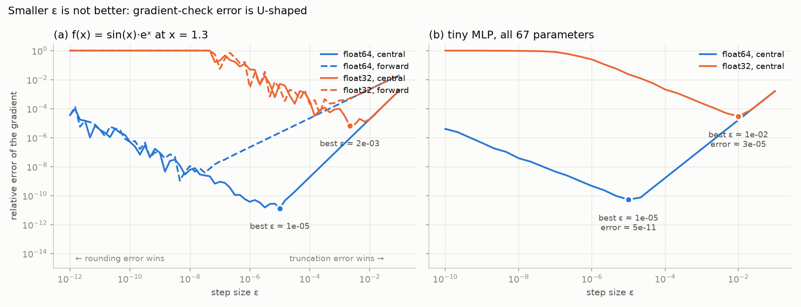

# 01 · autograd

A small autograd engine on numpy (~190 lines), and a look at how much you can trust a gradient check.

I started here instead of attention because everything after this needs gradients.



I'd always used eps = 1e-6 for gradient checks without really knowing why. Turns out that's only fine in float64. In float32 the same check says a correct gradient is 25% off, and it misses bugs of 1e-4 and smaller at any eps. In float64 it gets down to ~5e-11 error and catches a bug of 1e-6.

Theory says the best eps for central differences is around u^(1/3), where u is machine epsilon: the truncation error shrinks with eps, but rounding error grows like u/eps. What I measured was within 2-3x of that in every case.

| | best eps (predicted / measured) | error at best eps | error at eps = 1e-6 | smallest bug caught |
|---|---|---|---|---|
| float64 | 6e-6 / 1e-5 | 5e-11 | 4.6e-10 | 1e-6 (smallest I tried) |
| float32 | 5e-3 / 1e-2 | 3e-5 | 0.25 | 1e-3 |

(Numbers from the 67 parameter MLP in `run.py`. Bugs tried from 1e-1 down to 1e-6; caught means the check's error is at least 10x above what it gives on the correct gradient.)

## Files

- `autograd.py`: the engine. Tensor ops, broadcasting, batched matmul, softmax and cross entropy
- `gradcheck.py`: finite difference checker, reused by later modules
- `test_autograd.py`: 29 checks, every op against finite differences plus a few end to end ones
- `run.py`: the eps experiment, makes the chart
- `notebooks/`: the same thing step by step, if you want the explanation ([01](notebooks/01_scalar_autograd.ipynb), [02](notebooks/02_tensor_autograd.ipynb), [03](notebooks/03_gradcheck_experiment.ipynb))

## Notes

- One of the tests gives gradcheck a deliberately wrong derivative and checks that it fails. Otherwise passing tests don't prove much.
- Naive softmax on `[1000, 1001, 1002]` gives nan (exp overflows). Subtracting the max fixes it exactly, since softmax doesn't change when you shift all inputs by a constant.
- First version of `backward()` was recursive and crashed at ~1000 ops (Python's recursion limit). It uses a stack now.
- The spiral MLP in notebook 2 hit 99.3% train accuracy and I thought it was overfitting. Held out set: 99.0%.

## Run

```bash
conda env create -f ../environment.yml
conda activate llm-lab
python test_autograd.py
python run.py
```
