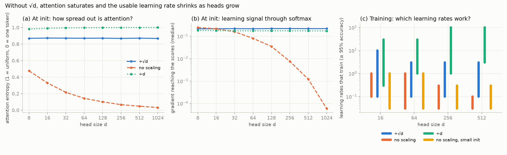

# 02 · attention

Attention and a full transformer block (multi-head attention, causal mask, LayerNorm, MLP, residuals, sinusoidal and RoPE positions), built on the autograd engine from 01. It didn't need any new engine ops.

The question for this one: why does attention divide the scores by √d?



Every explanation says "so softmax doesn't saturate", and I wanted to see what that actually means. A score q·k is a sum of d terms, so without scaling its spread grows like √d: about 3 at d = 8, 32 at d = 1024. At d = 1024 each query puts ~96% of its weight on one random token before any training, and the gradient getting back through softmax is thousands of times smaller than with ÷√d (5.9e-5 vs 0.22 in this run, the exact ratio moved between ~3,000x and 9,000x across seeds). Dividing by d goes too far the other way and attention starts out completely uniform.

What surprised me is that the unscaled version still learned. On a small task (find the token that matches the query, one head, plain SGD) it got to 99-100% as long as the learning rate was small enough. What breaks is the range of learning rates that work:

| | d = 16 | d = 64 | d = 256 | d = 512 |
|---|---|---|---|---|
| ÷√d | 0.1 - 10 | 0.1 - 3 | 0.1 - 3 | 0.1 - 3 |
| no scaling | 0.1 - 1 | 0.03 - 1 | 0.03 - 0.3 | 0.03 - 0.1 |
| ÷d | 0.3 - 30 | 1 - 30 | 1 - 100 | 3 - 100 |
| no scaling, small init (control) | 0.03 - 1 | 0.03 - 1 | 0.03 - 0.3 | 0.03 - 0.3 |

(Learning rates that reach at least 95% accuracy over the last 50 of 300 steps. I tried 0.03 to 100, so a window that ends at 0.03 or 100 is the edge of the grid and might go further.)

Without √d the largest working learning rate drops 10x between d = 16 and d = 512. With it, the same learning rate works at every size.

My first explanation for that was the saturation, so I tested it. The last row is a control: no scaling, but Wq and Wk start smaller, so the scores start out exactly like ÷√d and nothing is saturated. Its window shrinks the same way as no scaling up to d = 256, and at 512 it's only one step better (0.3 vs 0.1), probably because the smaller weights also make each update smaller, which fits the next part. So saturation isn't the reason. The scale factor also decides how far each update moves the scores, and without √d the same learning rate moves them further as d grows. ÷d is never saturated and drifts too, just in the other direction.

So the full answer: without √d, attention starts saturated, and each update moves the scores further as d grows, so the usable learning rate shrinks. √d keeps both independent of d, which is why you can tune a small model and make the heads bigger without retuning.

Caveats: one task, one seed, plain SGD. Adam rescales gradients and probably hides part of this, I'll check that once AdamW exists in 03.

## Files

- `transformer.py`: attention, causal mask, multi-head, LayerNorm, GELU MLP, sinusoidal and RoPE, and `block()`. Imports the engine from `../01-autograd`
- `test_transformer.py`: 14 checks. Gradchecks for every piece and a full block, LayerNorm against its closed form, multi-head against a slow per-head loop, no future leak, RoPE depending only on distance
- `run.py`: the √d experiment, makes the chart. `--quick` skips the slow d = 512 runs
- `notebooks/`: the same thing step by step ([01](notebooks/01_attention.ipynb) attention, [02](notebooks/02_transformer_block.ipynb) the block, [03](notebooks/03_experiment.ipynb) the experiment)

## Notes

- The causal mask is just a constant matrix of -inf added before softmax. exp(-inf) = 0, so masked positions get exactly zero weight and exactly zero gradient with the ops the engine already had. LayerNorm's square root is `** -0.5`, and RoPE's swap-each-pair step is a fixed matrix, so it's one matmul.
- The leak test checks that earlier positions change by exactly 0.0 when a later token changes, not "close to 0".
- My first "no mask means it leaks" demo showed almost no leak (1e-9). The random weights were too large, softmax was already saturated and every query only looked at one token. The √d problem showed up before I got to it. Normal init scale fixed the demo.
- The first version of the experiment used 300 queries per point, and the d = 1024 gradient moved by about 7x between seeds. With 2,000 it's within about 2.5x, enough to trust "thousands of times smaller" but not the exact number.

## Run

```bash
conda activate llm-lab
python test_transformer.py
python run.py            # ~20 min
python run.py --quick    # ~5 min
```
