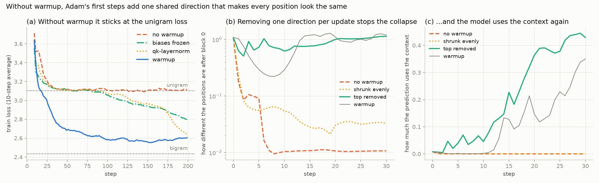

# 03 · tiny GPT

A character-level GPT (0.82M parameters, 4 layers) trained on *The Adventures of Sherlock Holmes*, using the engine from 01 and the transformer block from 02. AdamW, the warmup + cosine schedule, gradient clipping and sampling are all hand-written. The only new engine op is the embedding lookup.

The question for this one: why does training without warmup get stuck?



I started out looking for loss spikes. I trained 8 short runs with and without warmup and clipping, at learning rates up to 10x the good one, and none of them spiked. What did happen is that without warmup the loss got stuck at 3.1, which is exactly the loss of a unigram model (always predict the overall character frequencies). Clipping barely made a difference, and warmup fixed it every time.

So I measured what the model was doing. Without warmup, two steps in, it makes the same prediction at every position, whatever the text says. Block 0 is where it happens: after it, the vectors at different positions are almost identical (about 1% of the size is left that differs between positions, against ~100% at init).

The cause is Adam's first steps. At init every position's gradient says the same thing ("predict the common characters more"), so each weight matrix's gradient points mostly in one direction (80-99% of its energy). Adam's first update is about ±lr per weight, whatever the gradient's size, and at lr 3e-2 that one direction ends up 4x stronger than anything already in the matrix (6.7x in the embedding). So block 0 adds the same big vector to every position.

To check that it's the direction and not just the step size, I edited every update during training (lr 3e-2, no warmup, first 30 steps):

| | how different positions are after block 0 | uses the context | loss |
|---|---|---|---|
| normal | 0.01 | 0.000 | 3.13 |
| update shrunk evenly | 0.03 | 0.000 | 3.11 |
| strongest direction removed | 1.13 | 0.429 | 2.71 |
| with warmup instead (reference) | 1.20 | 0.350 | 2.83 |

("Uses the context" is how much the predicted distribution changes between positions. 0 is a unigram model, the bigram model is at 0.64.)

Shrinking the update to the same size changes nothing. Removing that one direction stops the collapse, and the model is ahead of the warmup run after 30 steps. So warmup works by keeping that direction small while all the gradients still agree. Even the learning rate I actually train with (3e-3) is blind to the context for ~20 steps without warmup.

Two things I suspected first turned out not to be the cause. Attention does collapse to one-hot at high learning rates (Wortsman et al. 2023), but the run with warmup, the one that trains, has the larger attention scores. And the biases (added equally to every position) aren't it either: with them frozen at 0, or with qk-layernorm, the model still collapses at step 2. Both do let it escape after ~90-120 steps, where the normal run never does.

Caveats: one model size, one seed, one book, 200-step runs. Removing the top direction is a diagnostic here, not something I'd train with. Runs repeat to a few hundredths of a loss, not exactly, because numpy's multithreaded sums don't add in a fixed order.

**The √d check promised in 02.** Same retrieval task with Adam instead of SGD. √d still gives a wider range of learning rates that work, but the best learning rate no longer stays the same as the heads grow: the top of the range drops ~10x from d = 16 to 256, with or without √d. So "tune small, then scale up" from 02 only holds for SGD. This lines up with μP, which shrinks Adam's learning rate with width and scales attention by 1/d.

## The model

<!-- TODO after the full train.py run: final val loss, the table and a sample -->

| | val loss |
|---|---|
| uniform guess | 4.48 |
| unigram | 3.10 |
| bigram | 2.43 |
| this GPT, 600 steps (notebook 2, ~20 min) | 1.67 |
| this GPT, 5000 steps (`train.py`) | TODO |

## Files

- `gpt.py`: data, character tokenizer, the model (tied input/output embedding), sampling with temperature / top-k / top-p, checkpoints
- `train.py`: AdamW, warmup + cosine, gradient clipping, the training loop. Saves the best val checkpoint
- `sample.py`: text from the checkpoint
- `run.py`: the warmup experiment and the √d recheck, makes the chart
- `test_gpt.py`: 13 checks. Gradcheck of the whole model, no future leak, overfitting one batch, the AdamW and clipping properties, the sampling filters, checkpoint round trip
- `notebooks/`: the same thing step by step ([01](notebooks/01_data_and_model.ipynb) data and model, [02](notebooks/02_training.ipynb) training, [03](notebooks/03_experiment.ipynb) the experiment)

## Notes

- The embedding backward needs `np.add.at`. The obvious `W.grad[idx] += g` only adds one gradient per token when a token shows up more than once in the batch. It doesn't error, the model just trains worse. The gradient check fails it at 0.39.
- The first training run used up all 16 GB in a few steps. Every node's `_backward` closure points back at the node, so each step's graph is a reference cycle, and Python only frees those when its garbage collector runs. That's triggered by how many objects you create, not by how many bytes they hold, and one step is ~2,000 nodes holding ~3 GB. A `gc.collect()` after each step fixes it.
- The whole-model gradient check gives 2e-7 at the real init but 7e-9 with bigger embeddings. Not a bug: with 0.02 embeddings the gradients reaching the blocks are ~1e-3, and the finite-difference noise (~1e-9) is a bigger fraction of that.
- Training a step went from 10.3 s to 2.4 s after I gave `(B, T, C) @ (C, D)` its own path in 01's matmul.
- Greedy sampling gets stuck on "the state of the state of the ...".

## Run

```bash
conda activate llm-lab
python test_gpt.py
python train.py          # ~3 h, saves checkpoints/gpt.npz
python sample.py
python run.py            # ~35 min
python run.py --quick    # ~17 min
```
