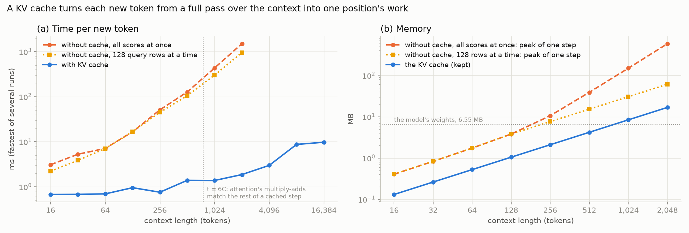

# 04 · KV cache

A KV cache for the GPT from 03, in plain numpy. Generation doesn't need gradients, so it skips the autograd graph too. Same model and same text, but each new token only runs one position through the model.

The question for this one: how much faster does generation get, and how much memory does the cache cost as the context grows?



To write the next token you normally run the model on everything so far. But earlier positions never change when you append a token (the causal mask from 02), so you can keep their keys and values and only compute the new one. With the trained model from 03, the cached version gives the same logits to 2e-14 at every step up to its 128-character limit, and exactly the same text, greedy and sampled.

The trained model only has 128 positions, so for longer contexts I used the same architecture with random weights. The output is nonsense, but the work per token and the memory don't depend on the weights: trained and random take the same time at the same context, within the noise of the timings.

| context | without cache, all scores at once | without cache, 128 query rows at a time | with cache |
|---|---|---|---|
| 16 | ~2-4 ms | ~2.7 ms | ~0.65-1.3 ms |
| 128 | ~15-24 ms | ~19 ms | ~0.7-1.5 ms |
| 512 | ~125-185 ms | ~123 ms | ~0.9-1.7 ms |
| 2,048 | ~1.4-1.7 s | ~1.06 s | ~1.9-3.3 ms |
| 16,384 | - | - | ~9.5-16 ms |

(Fastest of several tries per point. The first and last columns are ranges over seven runs on the same laptop, the middle one is from one run. Single timings move by up to 2x between runs, so read the shape, not the third digit.)

At 2,048 tokens the cache is ~530-760x faster than my first uncached forward, which builds all the attention scores at once. Against the fairer baseline, attention done 128 query rows at a time (same logits, see the memory part), it's ~430x.

Without the cache each new token redoes every position and attention over every pair, so it gets slower faster and faster (about 3-3.5x per doubling by 2,048 tokens). With the cache it's flat at ~1 ms up to ~512 tokens and then grows linearly. Counting multiply-adds, the bend is where attention over the cache catches up with the rest of the step: t = 6C = 768 for this model. In measured time it comes later, since at 768 tokens attention only adds ~0.3 ms to a step that is ~0.7 ms of fixed overhead. The measured speedups are always smaller than counting multiply-adds says (3-4x against 16x at 16 tokens), because a cached step is mostly a fixed ~1 ms of Python and numpy overhead at this size. Writing 512 tokens from scratch: ~27-34 s without, ~0.45-0.7 s with (~45-70x).

Memory. The cache is 8 KB per token here, so 16.8 MB at 2,048 tokens, and it passes the size of the model itself (6.55 MB) at 800 tokens. Without the cache nothing is kept between steps, but each step needs memory for attention. My first uncached forward built the scores for all t x t pairs at once and peaked at 581 MB at 2,048 tokens, which looked like 35x the cache. That's how I wrote it, not a cost of having no cache: doing attention 128 query rows at a time gives the same logits (to 1e-15), is faster, and peaks at ~61 MB, about 3.6x the cache. FlashAttention takes the same idea further on GPUs. So for one sequence the cache is still smaller than what a step without it needs, but not by much. The real cost shows up with many sequences at once, because the cache is kept for each of them. Calculated, not measured: Llama-2-7B needs 0.5 MB per token in fp16, 2.1 GB for one 4,096-token sequence, so 8 of them need more memory than the model's weights. That's why Llama-2-70B uses grouped-query attention: 10x the parameters, but a smaller cache per token (0.33 MB) than the 7B.

The limit: with learned position embeddings the cache can't slide past 128. Every cached key was made with its position baked in, and after dropping the oldest token they're all off by one. A naive sliding cache picks the same next character as the real model only 10% of the time. So past 128 `generate()` goes back to recomputing the last 128 characters every step, like 03. For short outputs the cache is much faster (100 characters in ~0.1 s), but for 300 characters it only goes from ~4.2 s to ~3.5 s, because most of them are past the limit.

Caveats: one laptop, float64 numpy on a CPU, not a GPU. The long contexts use random weights. At this size the cached step is overhead, not arithmetic, so a GPU or a bigger model would give a different speedup.

## Files

- `kv_cache.py`: the numpy forward (optionally doing attention a block of query rows at a time), the cache, chunked prefill, and `generate()` (falls back to recomputing past the context limit)
- `sample.py`: 03's sampler with the cache. `--no-cache` for the old way
- `run.py`: the experiment, makes the chart
- `test_kv_cache.py`: 11 checks. Same logits as 03's engine, blocked attention against all-at-once, prefill and one-token-at-a-time against the full forward, chunked prefill against one shot, cached generation against uncached, the same 200 characters as 03's sampler past the limit, and the cache refusing to overflow
- `notebooks/`: the same thing step by step ([01](notebooks/01_kv_cache.ipynb) building and checking the cache, [02](notebooks/02_experiment.ipynb) the experiment)

## Notes

- The first version of `run.py` compared the cache against an uncached forward that builds all t x t scores at once, and I wrote "35x the memory" from that. A review pointed out that's my implementation, not the cost of having no cache. The blocked forward is now in `run.py` next to it.
- The first version prefilled a 16k-token context in one call. That builds a 16k x 16k score matrix per head, about 8.6 GB in float64, and the run took 7.7 min instead of 2. Prefilling 256 tokens at a time gives the same cache. Real inference servers do chunked prefill for the same reason.
- Skipping the autograd graph is a speedup on its own: without any cache, 300 characters take ~4.2 s with the numpy forward against ~10 s through the engine in 03.
- Appending a token changes the earlier logits by exactly 0.0, not just "close to 0". That's the whole reason a cache is allowed.

## Run

```bash
conda activate llm-lab
python test_kv_cache.py
python run.py            # ~2.5 min
python run.py --quick    # ~40 s
python sample.py
```
